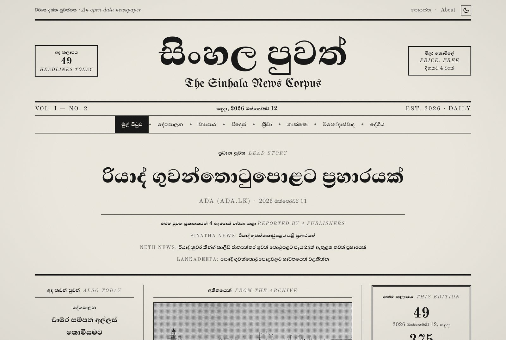

# Sinhala News Corpus

[](https://github.com/dhananjaya-hbc/sinhala-news-corpus/actions/workflows/daily-collect.yml)
[](LICENSE)
[](DATA_LICENSE.md)
[](https://dhananjaya-hbc.github.io/sinhala-news-corpus/)

An open, growing dataset of **Sinhala news headlines with topic labels**.
GitHub Actions collects it automatically four times a day from public RSS
feeds of Sri Lankan news sites, with no human in the loop.

**Browse the latest headlines: [dhananjaya-hbc.github.io/sinhala-news-corpus](https://dhananjaya-hbc.github.io/sinhala-news-corpus/)**
· **Size and label balance: [STATS.md](STATS.md)** (both updated on every run)
· **First analysis: [notebooks/01_eda.ipynb](notebooks/01_eda.ipynb)**

[](https://dhananjaya-hbc.github.io/sinhala-news-corpus/)

## Highlights

- **Fully automated data pipeline.** GitHub Actions collects, cleans, deduplicates, labels and
  commits new headlines every six hours, then rebuilds the website. No servers, no manual steps.
- **Sinhala-specific text cleaning.** Correct zero-width-joiner handling (ශ්‍රී, රාජ්‍ය), repair of
  old font-converter encodings, legacy-font detection, and Sinhala date parsing, with tests on real headlines.
- **Same-story detection across publishers.** TF-IDF over character trigrams groups headlines that
  report the same event despite Sinhala suffixes; the website's lead story is the most-covered one.
- **Measured data quality.** The [EDA notebook](notebooks/01_eda.ipynb) quantifies label balance,
  publisher–label confounding and label noise (publishers agree on the topic of a shared story about
  70% of the time).
- **Ethical by design.** Headlines and links only, robots.txt checked on every request, public-domain
  archive photographs, and automatic alerts (GitHub issues) when a feed keeps failing.
- **Tested and typed.** 137 Python tests; the Astro + TypeScript website is type-checked on every build
  and scores 89–95 for performance and 100 for accessibility in Lighthouse.

## Why

Sinhala is spoken by about 17 million people, yet it is a **low-resource
language** for NLP. There are few openly licensed, labelled Sinhala text datasets, and
much of the Sinhala text on the web is noisy in ways that break models:
pre-Unicode "legacy font" text that is really Latin characters, inconsistent
zero-width joiners, and HTML left over from content systems.

This project builds a small but clean and steadily growing resource for one
concrete task: **news topic classification**. Every row is a real headline,
cleaned and normalised, with a label taken from the publisher's own section or
category and mapped to a common label set.

## What's in the dataset

Monthly CSV files in [`data/raw/`](data/raw/), named `YYYY-MM.csv`, UTF-8, one headline per row:

| Column | Example | Description |
|---|---|---|
| `date` | `2026-10-11` | Publication date in Sri Lanka time (UTC+5:30). If the feed gives no date, the collection date is used. |
| `source` | `dinamina` | Source id, see the table below |
| `headline` | `පාකිස්තානයට එරෙහි අද තරගයේදී ශ්‍රී ලංකා ...` | Cleaned headline (NFC, see [Cleaning](#cleaning)) |
| `category` | `sports` | One of the 8 labels below |
| `url` | `https://www.dinamina.lk/2026/10/11/...` | Link to the original article (tracking parameters removed) |
| `collected_at` | `2026-10-11T01:00:42Z` | When the collector saw it (UTC) |

A row goes into the file for the month it was **collected** in, so files are
only ever appended to and each daily commit is a small diff.

### Labels

`politics` · `business` · `sports` · `international` · `entertainment` · `technology` · `local` · `other`

Labels come from the publisher, not from a model. Each site's section names
(e.g. Siyatha's `ක්‍රීඩා පුවත්`, Lanka Truth's `ආර්ථික පුවත්`, Neth News' `Foreign News`)
are mapped to this set in [`sources.yaml`](sources.yaml). When an item has
several categories, the most specific one wins:
`sports > entertainment > technology > business > international > politics > local > other`.
`local` is the catch-all for general domestic news.

### Loading it

```python
import glob
import pandas as pd

df = pd.concat(pd.read_csv(f) for f in sorted(glob.glob("data/raw/*.csv")))
df["category"].value_counts()
```

## Sources

| Source | Website | Feeds used | Where the label comes from |
|---|---|---|---|
| Lankadeepa (`lankadeepa`) | [lankadeepa.lk](https://www.lankadeepa.lk/) | politics, business, world news, latest news | The section feed itself |
| Neth News (`nethnews`) | [nethnews.lk](https://www.nethnews.lk/) | sports, international, politics, main feed | WordPress categories |
| Siyatha News (`siyatha`) | [siyathanews.lk](https://siyathanews.lk/) | sports, business, world news, main feed | WordPress categories |
| Lanka Truth (`lankatruth`) | [lankatruth.com/si](https://lankatruth.com/si/) | sports, economy, world news, main feed | WordPress categories |
| Ada (`ada`) | [ada.lk](https://www.ada.lk/) | technology, sports, business, international, breaking news | The section feed itself |
| Lanka C News (`lankacnews`) | [lankacnews.com](https://www.lankacnews.com/) | Technology, Arts, Economy, main feed | Blogger labels |

All headlines belong to these publishers; please credit them. To add or remove a
source, edit [`sources.yaml`](sources.yaml); no code changes are needed.

**Blocked from GitHub Actions.** Ada Derana Sinhala, Dinamina and Divaina
have working feeds, but their CDN firewalls (CloudFront, Cloudflare) return
HTTP 403 to GitHub's cloud IP addresses. They are kept in `sources.yaml` with
`enabled: false` rather than worked around: the project does not disguise its
User-Agent or route through proxies. You can re-test any feed from GitHub's
network with the **Check feeds** workflow (Actions → Check feeds → Run workflow).

**Evaluated but not used:** Hiru News and ITN (no RSS feed), Newsfirst Sinhala
(feed blocked, HTTP 403), Mawbima and Silumina (also blocked from GitHub),
BBC News Sinhala (excellent text but no categories in its feed), and several
English-language or opinion/weekly sites.

**Source bias to keep in mind:** Siyatha News publishes many China-related
stories, Lanka Truth is politically partisan, and Lanka C News is
tabloid-style (most of the `entertainment` label comes from its Arts feed).
STATS.md breaks every count down by source, so you can filter or re-weight them.

## How it works

```
GitHub Actions (every 6 hours: 06:30, 12:30, 18:30, 00:30 Sri Lanka time)
  └─ pytest                    # the cleaning rules must pass first
  └─ python -m collector.collect
       for each source / feed in sources.yaml
         check robots.txt → fetch feed (3 retries, backoff) → parse with feedparser
         clean headline → skip legacy-font text → map category
         skip if URL or normalised headline already stored
       append new rows to data/raw/YYYY-MM.csv
  └─ python scripts/stats.py   # regenerate STATS.md
  └─ commit "data: daily headlines YYYY-MM-DD" only if something changed
  └─ python scripts/source_alerts.py   # open/close an issue for feeds that keep failing
  └─ rebuild and deploy the website (deploy-site.yml)
```

- **One failing source never stops the others.** Each feed and each source is
  isolated; failures are logged and the run continues. The job only fails if
  *every* source fails.
- **Alerts for broken feeds.** Failing feeds are remembered in
  [`data/health.json`](data/) (only failures are stored, so a healthy day changes
  nothing). When a feed has failed on 2 different days, the workflow opens a GitHub
  issue labelled `source-failure` for that source, which GitHub emails to the owner.
  The issue lists the failing feeds and errors, is updated while the problem lasts,
  and closes itself when the feeds work again.
- **Retries:** network errors, timeouts, 429 and 5xx are retried 3 times
  (waits of 2, 4, 8 s). Permanent errors like 403/404 are not retried.
- **Deduplication** is checked against the whole history, on two keys: the URL
  (ignoring `http/https`, `www.`, trailing `/`, percent-encoding and tracking
  parameters) and the normalised headline (ignoring punctuation, quotes, spacing,
  ZWJ and the case of embedded English). That catches the same story being
  re-published under a new URL, or appearing in two feeds of the same site.
- **Commit author** comes from the repository variables `COMMIT_NAME` and
  `COMMIT_EMAIL`, falling back to `github-actions[bot]`.

## Website

[dhananjaya-hbc.github.io/sinhala-news-corpus](https://dhananjaya-hbc.github.io/sinhala-news-corpus/)
shows the last 30 days of headlines by topic and by source, with search.
Every headline links to the publisher's own article.

- **Design:** an old black-and-white newspaper: a nameplate with ears and a blackletter
  subtitle, a banner lead story, ruled columns, and a night edition printed as a negative.
  Type is Abhaya Libre (a Sinhala serif by Mooniak), Old Standard TT and UnifrakturMaguntia.
- **Pictures:** public-domain photographs of Ceylon from around 1900 (H.W. Cave & Co. 1901
  album, Library of Congress, New York Public Library), shown in greyscale with a halftone
  screen. They illustrate sections, never individual stories, and every caption says
  "Archive photograph" with the year. Credits and sources are on the site's About page and in
  `site/src/lib/archive.ts`. No news photographs are copied from publishers.
- **Stack:** [Astro](https://astro.build/) (static output), TypeScript, Tailwind CSS,
  self-hosted fonts, hosted on GitHub Pages. It ships almost no JavaScript, so pages
  load fast on mobile data.
- **Data:** `scripts/export_site_data.py` writes the recent rows to
  `site/src/data/site-data.json` at build time; the CSVs stay the source of truth.
- **Search** runs in the browser over a small JSON index. Queries and headlines are
  normalised the same way as the corpus (NFC, ZWJ removed), so typing `ශ්රී`
  without a ZWJ still finds `ශ්‍රී`.
- **Deploys** after every daily collection, on changes to `site/`, or manually
  from the Actions tab.

## Cleaning

The rules are in [`collector/sinhala_text.py`](collector/sinhala_text.py), with
tests built on real headlines in [`tests/test_sinhala_text.py`](tests/test_sinhala_text.py).

1. **HTML:** tags are stripped and entities decoded, twice, because some feeds
   double-escape (`&amp;quot;`).
2. **Unicode NFC:** Sinhala vowel signs can be typed as two code points. For
   example `ො` can arrive as `ෙ` (U+0DD9) + `ා` (U+0DCF). NFC turns them into the
   single code point (U+0DDC) so identical words compare equal.
3. **Invisible characters:** zero-width spaces, BOMs and soft hyphens are removed.
   Lankadeepa really published `ප්‍රභාකරන්​ගේ` with a U+200B hidden inside.
4. **Zero-width joiner (U+200D):** see below.
5. **Whitespace:** runs of spaces, tabs, newlines and non-breaking spaces become
   one space.
6. **Site-name suffixes and markers:** e.g. `… - Ada Derana Sinhala`, `… | දිවයින` or
   Siyatha's `…(VIDEO)` are removed.

### The ZWJ problem

In Sinhala, the invisible **zero-width joiner** is part of correct spelling.
It tells the renderer to join a consonant and the hal kirima (`්`) with the
next letter into a special form:

| Form | Example | Code points |
|---|---|---|
| rakaransaya | ශ්‍රී, ප්‍රවෘත්ති | consonant + `්` + ZWJ + `ර` |
| yansaya | රාජ්‍ය | consonant + `්` + ZWJ + `ය` |
| repaya | කාර්‍යය | `ර` + `්` + ZWJ + consonant |
| touching letters | ලක්‍ෂ | consonant + `්` + ZWJ + consonant |

Removing every ZWJ, as many generic "clean text" functions do, turns
`ශ්‍රී ලංකාව` into `ශ්රී ලංකාව`, a different string that displays wrongly.
Keeping every ZWJ leaves strays from copy/paste and CMS editors (after vowel
signs, between words, doubled) that make identical headlines look different.
The cleaner **keeps ZWJ only in the patterns above** (plus the older
SLS 1134 order consonant + ZWJ + `්` for touching letters) and removes the rest.

Old font converters add a third variant. Lanka C News writes `ප්‍ර` as
`ප` + ZWJ + `්` + ZWJ + `ර`, and some sites keep only the first ZWJ (`ප‍්ර`),
which shows a broken rakaransaya. Sinhala has no touching-letter form with
`ර` or `ය`, so both are rewritten to the standard `ප` + `්` + ZWJ + `ර`.
When a rule like this improves, `python scripts/reclean.py` re-applies the
current rules to the rows already stored.

### The legacy-font problem

Before Unicode was widely used, Sinhala sites used fonts such as *FM Abhaya*
that draw Sinhala letters on top of Latin code points. Without the font, the text
`ශ්‍රී ලංකා රජය` is stored as **`Y%S ,xld rch`**. It is unreadable, and
poison for a language model.

The collector measures the share of letters in the Sinhala Unicode block
(U+0D80–U+0DFF). Legacy text scores about 0; real headlines score near 1.0.
Even brand-heavy press releases such as
`Sumathi Information Technologies 25 වැනි සංවත්සරය සමරයි` stay above 0.35.
Headlines below **0.3** (configurable as `min_sinhala_ratio`) are skipped and logged.

## Ethics and copyright policy

- **Headlines and links only.** The collector reads the RSS feed and saves the
  headline, link, date and category. It **never** stores article text or
  summaries, even when the feed includes them, and **never requests article pages**.
- **robots.txt is respected.** It is checked before every feed request, both for
  this project's user agent and for `*`. If robots.txt can't be reached, the
  site is treated as disallowed (RFC 9309).
- **Four times a day,** every 6 hours (06:30, 12:30, 18:30 and 00:30 Sri Lanka time).
  Feeds only hold their latest items, so this catches headlines that would otherwise
  scroll off between runs. There is a 1 s pause between feeds of the same site: about
  25 small requests per run, so each site gets roughly 16-20 feed requests a day.
- **Identifiable:** requests use the User-Agent
  `sinhala-news-corpus/1.0 (+https://github.com/dhananjaya-hbc/sinhala-news-corpus)`.
- **Credit and removal:** every row names its source and links back to it.
  Publishers who want their source removed can open an issue.

## License

- **Code:** [MIT](LICENSE). Short and permissive, so anyone can reuse the
  collector and cleaning functions for other Sinhala projects.
- **Data:** [CC BY 4.0](DATA_LICENSE.md). It covers this project's
  contribution: the selection, cleaning and labels. It allows any use,
  including training and publishing models, with attribution. CC BY is the
  usual choice for NLP datasets and works well on Hugging Face. The headlines
  themselves stay the property of their publishers, which is why every row
  keeps `source` and `url`.

## Known limitations

- Feeds only list their latest 10–50 items. Collecting every 6 hours and using
  section feeds captures most of each site's output, but a very busy site can still
  publish more between two runs than its feed holds.
- Labels are the publishers' own categories: useful but noisy, and imbalanced.
  `politics` is the smallest class: most sites have no politics section, and
  political stories are often filed under local news.
- Section feeds can reach back years (Siyatha's go back to 2021), so the first
  run for a new source backfills older headlines with their real dates.

## Running locally

```bash
python -m venv .venv && source .venv/bin/activate
pip install -r requirements-dev.txt
python -m pytest                       # run the tests
python -m collector.collect --dry-run  # fetch and report, write nothing
python -m collector.collect            # append new headlines to data/raw/
python scripts/stats.py                # regenerate STATS.md
python scripts/reclean.py --dry-run    # preview re-cleaning stored headlines
python scripts/check_feeds.py URL ...  # test a feed before adding it

# analysis notebook
pip install -r requirements-analysis.txt
jupyter nbconvert --to notebook --execute --inplace notebooks/01_eda.ipynb

# website (Node 22.12+)
python scripts/export_site_data.py     # export recent headlines for the site
cd site && npm install && npm run dev  # http://localhost:4321/sinhala-news-corpus/
```

## Roadmap

- [x] Daily automated collection with cleaning and deduplication
- [x] Website with topic and source pages and Sinhala-aware search
- [x] **EDA (first pass):** label balance, publisher–label confounding, headline length, vocabulary and
  label agreement on shared stories: [notebooks/01_eda.ipynb](notebooks/01_eda.ipynb). Re-run when there is more data.
- [ ] **Baseline classifier:** TF-IDF (character n-grams) + logistic regression / linear SVM
- [ ] **Transformer fine-tuning:** XLM-R and Sinhala models such as SinBERT
- [ ] **Hugging Face dataset release** with fixed train/validation/test splits
- [ ] More sources, possibly including unlabelled feeds such as BBC Sinhala for pre-training text

## Citation

```bibtex
@misc{sinhala_news_corpus,
  author       = {Dhananjaya Chamod},
  title        = {Sinhala News Corpus: daily Sinhala news headlines with topic labels},
  year         = {2026},
  howpublished = {\url{https://github.com/dhananjaya-hbc/sinhala-news-corpus}}
}
```
